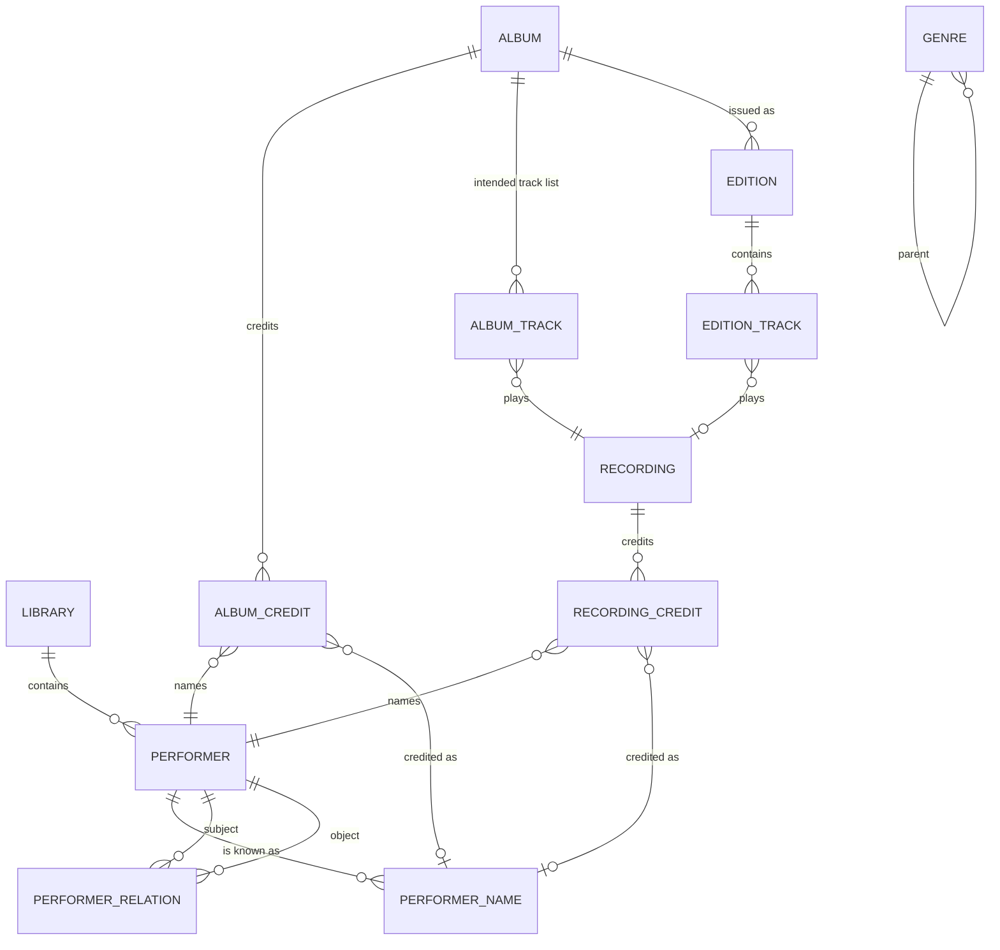

# Domain model

The curated catalog this application maintains. It is the system of record for curation: imports from Apple Music add entities and refresh the Apple mirror, but never overwrite curated fields. Decision record: [ADR-0004](adr/0004-domain-model.md).

Every table below except the authentication tables carries `library_id`; one library is the datastore for one Apple ID ([ADR-0003](adr/0003-library-partitioning-and-isolation.md)). Positions and disc indexes are 0-indexed (standards §6); printed track numbers are kept as labels.

## Entities

### Performer

Any credited person or collective: an individual, band, duo, choir, orchestra or ensemble. Kinds are a declared taxonomy in `data/taxonomies/performer-kinds.json`.

| Field | Meaning |
|---|---|
| `kind` | Taxonomy key: `person`, `group`, `duo`, `orchestra`, `choir`, `ensemble`, `other` |
| `began`, `ended` | Partial dates (`YYYY`, `YYYY-MM` or `YYYY-MM-DD`): birth and death, or formation and dissolution |
| `area` | Free text: country, city or region |
| `disambiguation` | Short text that tells two same-named performers apart |
| `notes` | Free text |

### Performer name

A performer has one or more names. Exactly one is preferred for display.

| Field | Meaning |
|---|---|
| `name`, `sort_name` | The name as written and its sort form (`Beatles, The`; `Cash, Johnny`) |
| `kind` | Taxonomy key: `primary`, `legal`, `birth`, `stage`, `alias`, `spelling-variant`, `former`, `transliteration`, `abbreviation` |
| `locale` | Optional BCP 47 tag for the language or script of the name |
| `valid_from`, `valid_to` | Partial dates bounding when the name was in use |
| `is_preferred` | Exactly one preferred name per performer (partial unique index) |
| `match_key` | Normalized form used for matching imports; computed by one PURE function |

### Performer relation

A standing relationship between two performers, independent of any one recording.

| Kind | Reads as | Example |
|---|---|---|
| `member-of` | subject is a member of object | John Lennon is a member of The Beatles |
| `conductor-of` | subject is principal conductor of object | A conductor's tenure with an orchestra |
| `music-director-of` | subject directs object | A choir's music director |
| `subgroup-of` | subject is a section or offshoot of object | A chamber ensemble drawn from an orchestra |
| `persona-of` | subject is a persona or project of object | A stage persona treated as its own performer |
| `successor-of` | subject continued object under a new identity | A band re-formed as a different entity |
| `collaborator-with` | symmetric standing partnership | A long-running pairing that is not a group |

Relations carry `roles` (instruments or functions), `began`, `ended` and `notes`. A rename of the same entity is a new **name**, not a `successor-of` relation.

### Recording

One captured performance. A recording is first-class: the same recording can appear on several albums and editions, and a remaster of the same performance stays the same recording.

| Field | Meaning |
|---|---|
| `title`, `version_note` | Title, and what distinguishes this recording from others of the same piece (`live, Fillmore East, 1971-03-13`) |
| `kind` | Taxonomy key: `studio`, `live`, `demo`, `rehearsal`, `alternate-take`, `remix`, `edit`, `session`, `interview`, `spoken-word` |
| `recorded_from`, `recorded_to`, `venue` | When and where it was recorded |
| `duration_ms` | Duration |
| `notes` | Free text |

### Credits

`recording_credit` and `album_credit` link a performer to a recording or album with a role, an order, an optional join phrase and optional instruments or parts (`violin`, `lead vocals`). `credited_name_id` records which of the performer's names appeared on that credit, so "John R. Cash" on one album and "Johnny Cash" on another remain one performer; without it the credit shows the performer's preferred name.

Roles are a declared taxonomy in `data/taxonomies/credit-roles.json`: `primary`, `featured`, `soloist`, `accompanist`, `conductor`, `orchestra`, `choir`, `ensemble`, `composer`, `lyricist`, `arranger`, `producer`, `remixer`.

| Situation | How it is recorded |
|---|---|
| A person in a band | `member-of` relation; the band is credited on its recordings |
| A duet | Two `primary` credits on the recording, joined by `" & "` |
| A standing duo | A performer of kind `duo` with two `member-of` relations |
| A featured artist | A `featured` credit, joined by `" feat. "` |
| A soloist with an orchestra | `soloist`, `orchestra` and `conductor` credits on each recording |

### Album, edition and track

| Entity | Is | Holds |
|---|---|---|
| `album` | The release its artists intended | Title, kind, original release date, label, album credits, genres |
| `album_track` | One slot of the intended track list | Disc index, position, recording, printed title and label |
| `edition` | One issued form of the album: an Apple library album, an Apple catalog album, or a manually entered edition | Title as issued, edition kind, release date, source reference |
| `edition_track` | One track of an edition | Disc index, position, title as issued, recording, inclusion |

| Field | Meaning |
|---|---|
| `album.kind` | Taxonomy key from `data/taxonomies/album-kinds.json`: `album`, `ep`, `single`, `compilation`, `live`, `soundtrack`, `broadcast`, `spoken-word`, `other` |
| `album.released`, `edition.released` | Partial dates: the album's first release, and this edition's |
| `album.label`, `album.notes`, `edition.notes` | Free text |
| `album_track.recording_id` | Required: an intended slot always plays a known recording |
| `album_track.title`, `album_track.label` | Optional printed title, when it differs from the recording's, and printed number (`A1`) |
| `edition_track.title` | Required: the title as the edition issued it |
| `edition_track.recording_id` | Optional: a track whose recording has not been identified yet names none |

Album credits work as recording credits do. The source reference that ties an edition to an Apple library or catalog album arrives with the Phase 3 import.

An album's identity does not depend on its track credits ([R-20](PLAN.md#requirements)). A soloist's album assembled from three sessions with three orchestras is one album with one intended track list; each recording keeps its own credits.

`edition_track.inclusion` states how a track relates to the intended album. Values are a declared taxonomy in `data/taxonomies/track-inclusions.json`, in three families: `intended` (`core`, `hidden`), `extra` (`bonus`, `demo`, `live`, `alternate`, `interview`, `commentary`, `remix`, `instrumental`, `single-edit`) and `unclassified` (`unknown`). Imports classify tracks heuristically from title markers declared in `data/classification/track-title-markers.json`, with the matched marker kept as evidence; curated classification overrides the heuristic and is never reverted by later imports.

Edition kinds are a declared taxonomy in `data/taxonomies/edition-kinds.json`: `original`, `remaster`, `deluxe`, `expanded`, `anniversary`, `super-deluxe`, `reissue`, `regional`, `clean`, `explicit`, `unknown`.

### Genres

Genres are curated per library and may nest (`parent_id`). Apple genre names map to curated genres through `genre_alias`, so a change of mind about a genre is one edit. Albums, recordings and performers each carry their own genre assignments.

| Entity | Holds | Rules |
|---|---|---|
| `genre` | Name, optional parent, notes | Sibling names are unique, top-level names included; never its own ancestor; not deleted while it has subgenres or uses |
| `genre_alias` | Another name for a genre | Names one genre in a library; deleted with its genre |
| `album_genre`, `recording_genre`, `performer_genre` | The entity's genres in order; the first is its main genre | At most 20; a genre appears once |

Genres on an album describe the album, on a recording the recording, and on a performer the performer's work in general; none is inferred from another.

### External identifiers

`performer_external_id`, `album_external_id`, `edition_external_id` and `recording_external_id` hold identifiers by namespace: Apple library and catalog ids, ISRC, UPC, MusicBrainz ids, Discogs ids, Wikidata ids. Namespaces are a declared taxonomy.

## Apple mirror and change outbox

| Table | Holds |
|---|---|
| `apple_music_connection` | One per library: the encrypted Music User Token, its status and storefront |
| `apple_library_item` | Last fetched form of each Apple library song, album, artist and playlist: raw attributes, relationship ids, content hash, first and last seen, removal time |
| `apple_catalog_item` | Catalog enrichment fetched for library items: ISRC, composer, work and movement names, label, UPC, track counts |
| `sync_run` | One import run: status, counts by kind, error |
| `apple_change` | Proposed and applied changes to Apple Music: kind, planned request, status, result |

The mirror is a copy of data Apple owns; the curated tables are data this application owns. Imports read the mirror and create curated entities only where none are linked yet.

## Invariants

1. Every row belongs to exactly one library, and every reference stays inside that library (composite foreign keys on `library_id` plus the referenced id).
2. A performer has exactly one preferred name.
3. A relation never links a performer to itself.
4. Positions are unique within an album's disc and within an edition's disc.
5. Curated fields are never overwritten by an import; imports only add entities, refresh the mirror and record differences.
6. Nothing is written to Apple Music without an `apple_change` row approved by a library member.
7. Partial dates match `YYYY`, `YYYY-MM` or `YYYY-MM-DD`.
8. A recording on a track list, an album with editions, a performer or name a credit uses, and a genre with subgenres or uses are not deleted; the delete is refused.
9. A genre is never its own ancestor.

## Worked examples

| Case | Representation |
|---|---|
| A deluxe edition with demos and an interview | One album; its intended track list holds the original tracks; the Apple library album is an edition whose extra tracks are `demo` and `interview` |
| Apple splits one album into several because track artists differ | The library albums share a catalog album id or base title and become editions of one album, or are merged into it |
| A violinist's album drawn from concerts with two orchestras | One album credited to the violinist; each recording credits the violinist as `soloist`, its orchestra as `orchestra`, and its conductor |
| An artist who changed name | One performer with a `former` name and a current `primary` name, each with validity dates; credits keep the name used at the time |
| A singer featured on another artist's track | The track's recording has the main artist as `primary` and the singer as `featured` |
